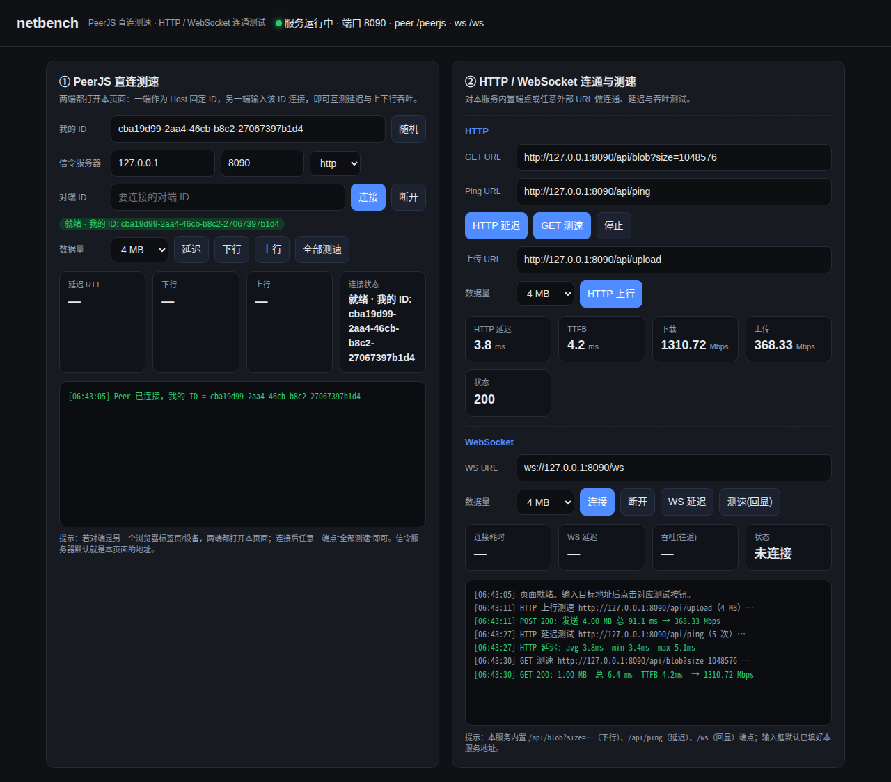

# netbench —— 单端口网络测速工具

监听 **8080**，在一个端口上同时提供测速页面、PeerJS 信令服务器、HTTP 测试端点和 WebSocket 回声端点。

## 快速开始

```bash
cd tools/netbench
npm install          # 首次
npm start            # node server.js
# 打开 http://localhost:8080/
```

- 默认监听 `0.0.0.0:8080`；`PORT=9090 node server.js` 换端口，`DEBUG=1` 开 peerjs 调试日志。
- 页面与信令共用 8080，PeerJS 客户端 `path` 固定为 `/peerjs`，无需另起信令进程。

## 功能

### ① PeerJS 直连测速
打开**两个**页面（两个标签页 / 两台设备）：

1. Host 端：填入固定 ID（如 `host1`）→ 点「随机」或直接改 ID 让 Peer 就绪。
2. Client 端：在对端 ID 填入 `host1` → 点「连接」。
3. 任意一端点「全部测速」：先测 5 次 ping 延迟，再测下行、上行吞吐（数据量可选 1/4/16/64 MB）。

协议是对称的：两端都运行本页面，收到 ping 自动回 pong、收到下行请求自动发数据并回报，因此只需在一端发起。

> PeerJS 是 WebRTC 数据通道直连，信令服务器只做握手，数据不经过服务器；结果反映两端之间的真实网络。

### ② HTTP / WebSocket 连通与测速
- **HTTP 延迟**：对目标 URL 做 5 次 GET，统计 avg/min/max。
- **GET 测速（下行）**：流式读取响应，给出 TTFB、总耗时、下载速度（Mbps）。
- **HTTP 上行**：POST size 字节到目标，按请求-响应往返计时，给出上传速度（Mbps）。
- **WS 连接**：测连接耗时；**WS 延迟**：JSON ping/pong 回显；**测速（回显）**：发送大数据并等完整回显，按往返计算吞吐。

内置端点（页面输入框已默认填好）：

| 端点 | 用途 |
|---|---|
| `/api/ping` | HTTP 延迟探测 |
| `/api/blob?size=1048576` | 下行吞吐（默认 1 MB，上限 512 MB，流式不占内存） |
| `POST /api/upload` | 上行吞吐（上限 512 MB，POST 请求体计数并回显收到字节数） |
| `/ws` | WebSocket 回声 |
| `/api/info` | 服务信息 |
| `/peerjs/` | PeerJS 信令 HTTP 信息 |
| `/peerjs/peerjs/peers` | 在线对端列表（allow_discovery） |
| `/vendor/peerjs.min.js` | 本地托管的 PeerJS 客户端库（离线可用） |

## 技术要点

- Node.js 内置 `http` + `express`；PeerJS 信令用 `peer`（peerjs-server，`ExpressPeerServer`）挂载在 `/peerjs`，客户端配置 `{ host, port, path: '/peerjs' }`。
- PeerJS 客户端库由服务端本地托管（`node_modules/peerjs/dist/peerjs.min.js`），不依赖 CDN。
- 测速协议为对称 JSON 控制消息（`ping/pong`、`req/got`、`send`）+ 分块二进制数据（64 KB 块，按 `bufferedAmount` 背压），两端自动应答。

## 文件

```
server.js         # HTTP + PeerJS 信令 + /api + /ws
public/index.html # 测速页面（原生 JS，无框架）
```

## 界面预览


